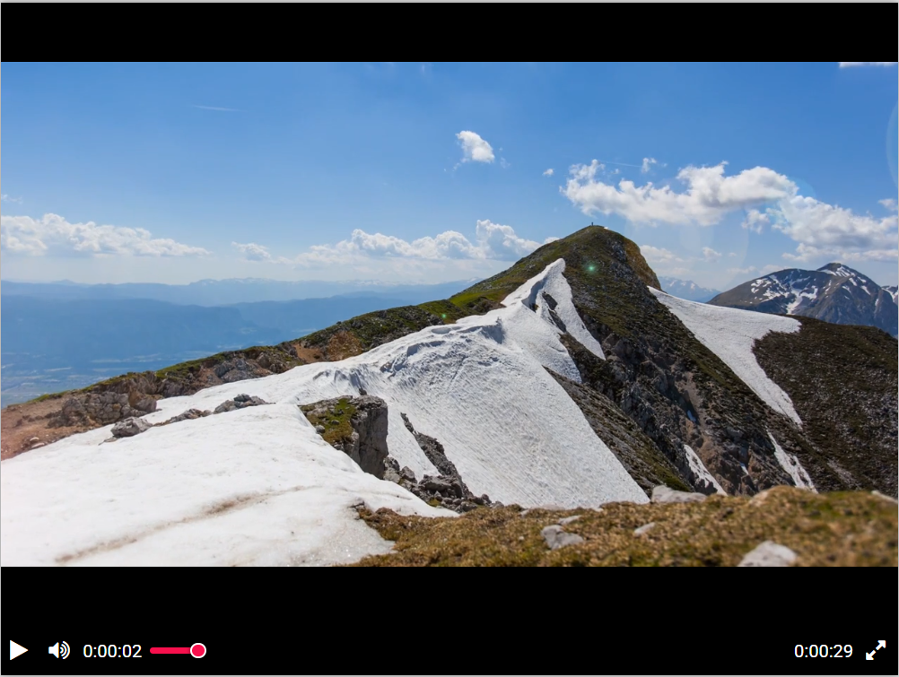

# Видеоплеер

Учебный проект по вёрстке и настройке видеоплеера на курсе [Devman](https://dvmn.org/). Интерфейс выполнен по макету дизайнера: чёрная панель управления, белые иконки и красная полоса воспроизведения.

**[Посмотреть видеоплеер на GitHub Pages](https://suba79.github.io/video_player/)**

## Возможности

- Воспроизведение и пауза видео — **Play / Pause**.
- Включение и выключение звука — **Mute / Unmute**.
- Отображение текущего времени и общей продолжительности ролика.
- Перемотка видео с помощью прогрессбара.
- Круглый ползунок, который движется вместе с прогрессом и плавно появляется при наведении курсора на полосу.
- Просмотр в полноэкранном режиме.
- Управление с помощью кнопок Font Awesome; видимый фокус при навигации клавишей `Tab`.

## Демо и скриншот

Откройте [онлайн-версию плеера](https://suba79.github.io/video_player/).



## Как запустить локально

1. Клонируйте репозиторий:

   ```bash
   git clone https://github.com/Suba79/video_player.git
   ```

2. Перейдите в папку проекта:

   ```bash
   cd video_player
   ```

3. Откройте `index.html` в браузере. При желании запустите локальный сервер, например с помощью расширения **Live Server** для VS Code.

> Для загрузки видео, шрифтов и JavaScript-библиотек требуется интернет. Если плеер не запускается, проверьте доступность внешних ресурсов и ошибки во вкладках **Console** и **Network** инструментов разработчика.

## Технологии

- **HTML5** — разметка страницы и элементов управления.
- **CSS3** — Flexbox, стили кнопок, `:hover`, `:focus-visible`, переходы и анимация прозрачности.
- **JavaScript** — логика работы плеера из [`player.js`](player.js).
- [Playable 2.10.3](https://wix.github.io/playable/) — библиотека воспроизведения видео.
- [jQuery 3.4.1](https://jquery.com/) — взаимодействие с элементами страницы.
- [Font Awesome 4.7](https://fontawesome.com/v4/) — иконки управления.
- [Google Fonts (Roboto)](https://fonts.google.com/specimen/Roboto) — шрифт таймера.

Для работы использована [библиотека видеоплеера из задания Devman](https://github.com/devmanorg/video-player-jslib). В качестве демонстрации загружается видео с сайта Devman.

## Структура проекта

```text
video_player/
├── index.html          # HTML-разметка и CSS-стили видеоплеера
├── player.js           # Подключение и управление видеоплеером
├── favicon.svg         # Иконка сайта
├── screenshots/
│   └── player.png      # Скриншот плеера
├── search.html         # Отдельное учебное HTML-упражнение
├── .gitignore
└── README.md
```

## Цель проекта

Закрепить навыки HTML, CSS и работы с JavaScript-библиотекой: сверстать элементы по макету, подключить управление видео, реализовать прогрессбар с анимированным ползунком и опубликовать результат на GitHub Pages.
