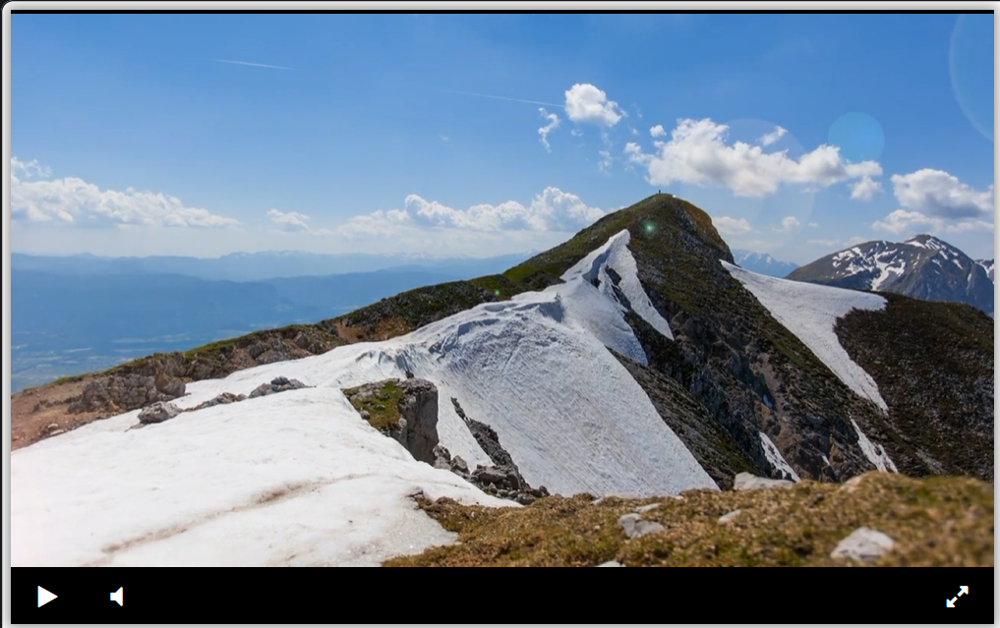

# Видеоплеер

Учебный проект по вёрстке видеоплеера в рамках курса [Devman](https://dvmn.org/).

**[Посмотреть работающий видеоплеер на GitHub Pages](https://suba79.github.io/video_player/)**

## Возможности

- Запуск и остановка видео (Play / Pause).
- Включение и выключение звука (Mute / Unmute).
- Просмотр видео в полноэкранном режиме.
- Панель управления с иконками Font Awesome.
- Размещение видео и панели управления с помощью CSS Flexbox.

## Скриншот



## Как запустить локально

1. Склонируйте репозиторий:

   ```bash
   git clone https://github.com/Suba79/video_player.git
   ```

2. Перейдите в папку проекта:

   ```bash
   cd video_player
   ```

3. Откройте файл `index.html` в браузере. Для локального сервера можно воспользоваться Live Server или Python LiveReload.

> Для загрузки внешних библиотек и видео потребуется подключение к интернету.

## Использованные технологии

- HTML5 и CSS3 (Flexbox).
- JavaScript.
- [Font Awesome 4.7](https://fontawesome.com/v4/).
- [jQuery 3.4.1](https://jquery.com/).
- [Playable 2.10.3](https://wix.github.io/playable/).
- [Библиотека видеоплеера Devman](https://github.com/devmanorg/video-player-jslib) (`player.js`).

## Структура проекта

```text
video_player/
├── index.html         # Страница видеоплеера
├── player.js          # Библиотека видеоплеера
├── search.html        # Учебное упражнение по HTML
├── screenshots/
│   └── player.png     # Скриншот готового плеера
├── .gitignore
└── README.md
```

## Цель проекта

Практика HTML-разметки, CSS-стилей, Flexbox и подключения готовой JavaScript-библиотеки к элементам интерфейса.
